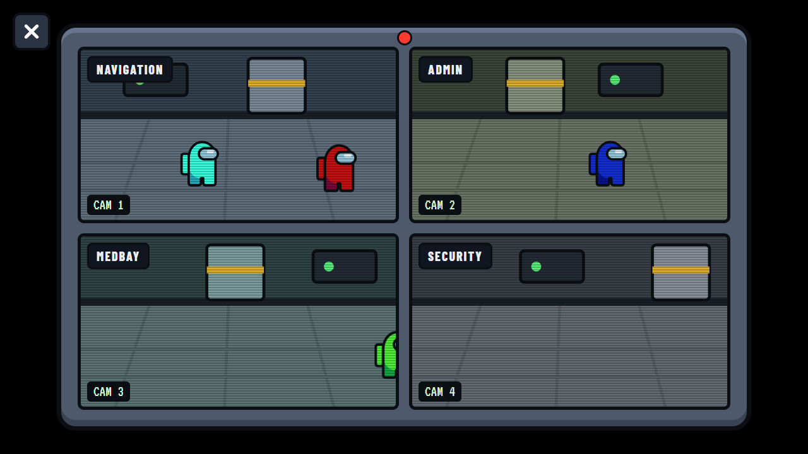
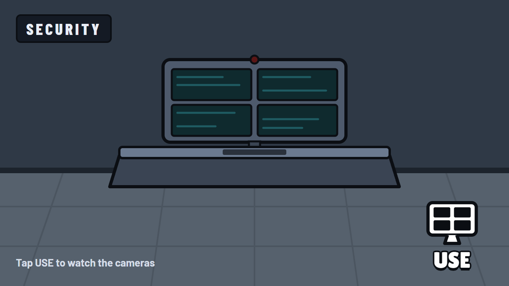
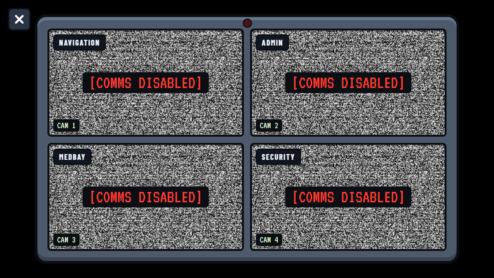
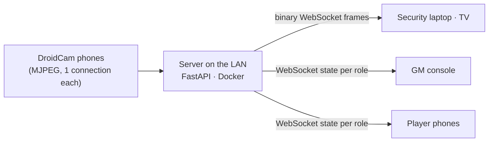

# Among Us IRL

**Real-life Among Us for house parties.** Old Android phones become security cameras, a laptop
becomes the Security room, the TV shows the spectator wall, and every player's own phone carries
their role, kills, meetings, votes and tasks.



> [!NOTE]
> **Status: paused during Phase 1.** The design is approved and the foundation is built. The
> camera modules are only partly written. There is nothing to run yet. See
> [currentstate.md](currentstate.md) and [progress.md](progress.md). The screenshots are the
> approved mock-ups; the app is being built to match them.

## How a game works

- **Security cameras.** Up to 4 phones running the free DroidCam app stream the hallways. At the
  Security station a player taps **USE** and the monitor opens. With fewer live cameras, fewer
  windows appear (1 = full screen, 2 = side by side, 3 = two plus one, 4 = 2×2). A dropped feed
  turns to static and its window closes. While someone is watching, the camera phones blink
  their flashlight, like the red light in the game.
- **Roles and kills.** Players join by scanning a QR code on the TV. The server deals the roles
  ("Shhhhh!"). Everyone wears a QR badge on their back. An impostor kills by scanning a
  crewmate's badge. Anyone who finds a body reports it by scanning theirs.
- **Meetings and voting.** Meetings start from the emergency-button station, from a body
  report, or from the game master. Discussion happens in the room, voting on the phones, and the
  ejection plays on every screen.
- **Tasks.** Printed QR codes around the house open mini-games on the player's phone: Swipe
  Card, Fix Wiring, Download/Upload, Fuel Engines, Clear Asteroids and Start Reactor. Impostors
  get fake task lists. When all tasks are done, the crew wins.
- **Comms sabotage.** Impostors can cut communications. The cameras go to static, task lists and
  room names disappear, and no new task can start until someone fixes comms at the radio-dial
  station.
- **Game master.** One person runs the game from a PIN-protected console. They set up the
  cameras and screens, see every role, vote and task, and can fix mistakes.

<table>
  <tr>
    <td></td>
    <td></td>
  </tr>
  <tr>
    <td align="center">Security station, idle</td>
    <td align="center">Comms sabotage: every feed turns to static</td>
  </tr>
</table>

## How it works



- **One connection per phone.** DroidCam serves only one viewer at a time, so the server holds
  the single connection and relays the frames to every screen.
- **Frames over a WebSocket, not `` streams.** Browsers allow only 6 HTTP connections per
  host, and four MJPEG streams would block every other request. The WebSocket also gives each
  screen its own frame-rate cap (TVs get 15 fps).
- **The server decides everything.** Each client gets only its own view. Player phones never
  receive camera data or anyone else's role.
- **Pairing.** Screens join with a 4-letter code that the game master approves. The GM console
  is protected by a PIN (argon2) and access is checked again live whenever something changes.

## What you need

- A computer on the home network that runs Docker (the original setup uses a small Ubuntu
  server).
- 1–4 Android phones with **DroidCam Webcam & OBS Camera** (free; the flashlight blink needs
  DroidCam Pro).
- A laptop for the Security station and a TV with a browser (TV Bro works on Android/Google TV).
- The players' own phones, and a printer for the badges and task QR codes.

The full walkthrough (phone settings, screens, pairing, the game master's first login) is in
[docs/SETUP.md](docs/SETUP.md).

## Development

```powershell
# backend: Python 3.12+
cd backend
py -3.13 -m venv .venv
.\.venv\Scripts\python -m pip install -r requirements-dev.txt
.\.venv\Scripts\python -m pytest

# frontend: Node 22+
cd ..\frontend
npm ci
npm run typecheck
npm test

# after changing backend/app/models.py, regenerate the TypeScript types
..\backend\.venv\Scripts\python ..\scripts\gen_types.py
```

When Phase 1 is done, the backend runs with `uvicorn app.main:app --port 8740`, the frontend with
`npm run dev` (it proxies `/api`, `/ws` and `/cam` to port 8740), and simulated phones with
`tools/fake_droidcam.py`. Set `AUI_RELAY_MODE=fake` (the default) so a dev instance never takes a
real camera away from the server.

## Project layout

```
backend/app/        FastAPI app: models (wire contract), config, storage, auth, cams/ ...
frontend/src/       React + TypeScript: api/, monitor/, views/, components/, theme/, sound/, i18n/
design/mockups/     the approved mock-ups (Design Component artboards)
docs/               CONTRACT.md (technical spec), SETUP.md (party setup), images/, handoff/
scripts/            gen_types.py (Pydantic → TypeScript), deploy tooling
plan.md             the plan · currentstate.md: where things stand · progress.md: checklist
```

## Roadmap

| Phase | What | Status |
|---|---|---|
| 0 | Mock-ups of every screen | ✅ approved |
| 1 | Cameras, screen pairing, GM setup, Security and spectator views, deploy | 🟡 paused mid-build |
| 2 | Join, badges, roles, kills and reports, meetings, voting, comms sabotage, win detection | ⬜ |
| 3 | Task spots, 6 mini-games, task bar, task win | ⬜ |

## Branches

- `main`: stable. Updated when a phase passes its real-world test.
- `dev`: work in progress. Phase 1 continues here.

## Tech

Python 3.12, FastAPI, Pydantic v2, SQLite, python-zeroconf, httpx · React 19, TypeScript, Vite ·
Docker Compose · self-hosted fonts, sounds synthesized with WebAudio · English and Hungarian.

## License and disclaimer

The code is under the [MIT License](LICENSE).

This is an unofficial, non-commercial fan project for a house party. It is not affiliated with or
endorsed by Innersloth. *Among Us* is a trademark of Innersloth LLC. All art in this repository is
original (drawn in CSS/SVG), and all sounds are synthesized; no game assets are used.
